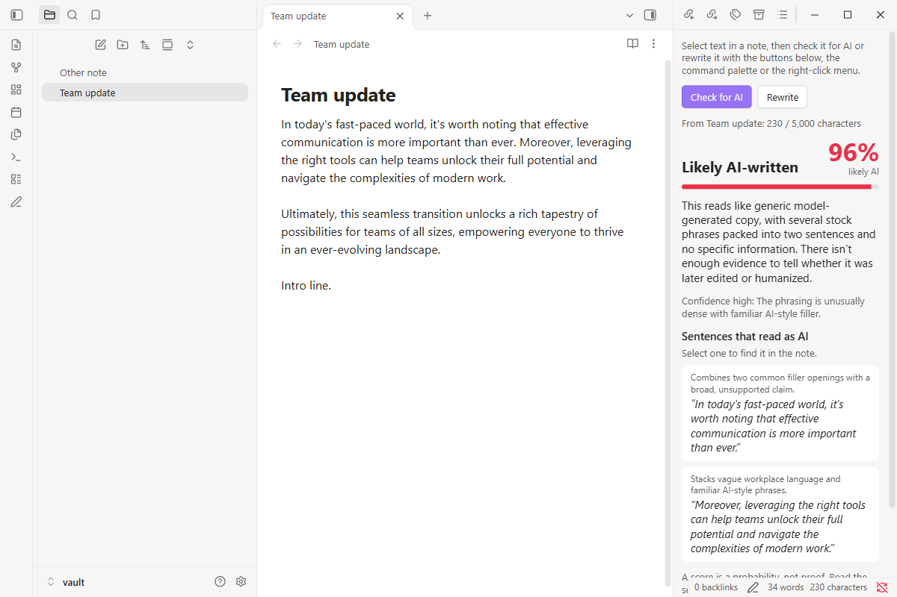
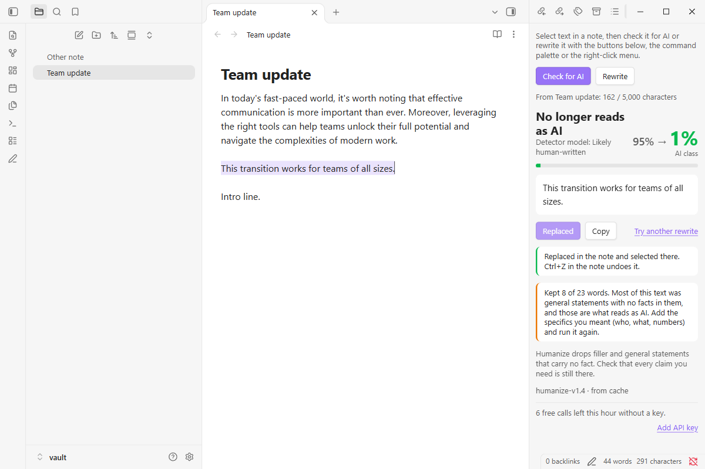
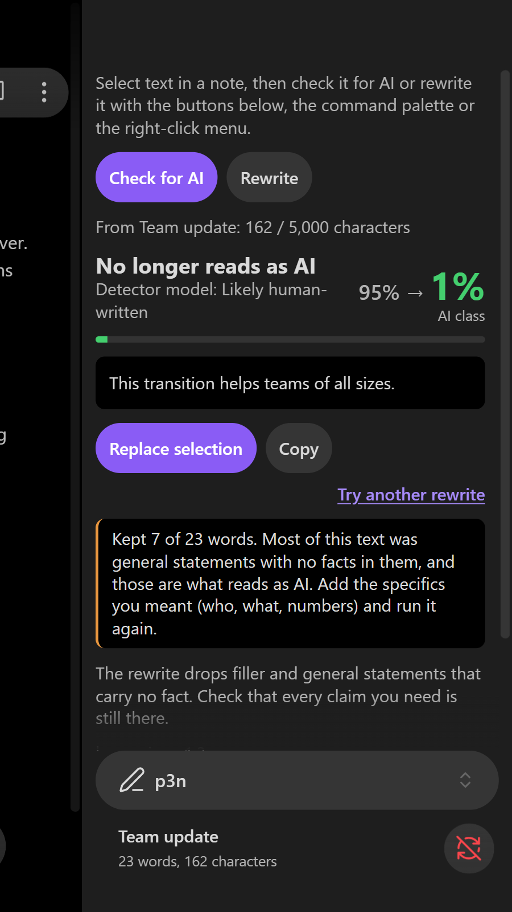

# p3n for Obsidian

Select text in a note. See if it reads as AI-written, or rewrite it in place.

[p3n.si](https://p3n.si) · [Community directory](https://community.obsidian.md/plugins/ai-pen) · [Privacy](PRIVACY.md) · also for [Chrome and Firefox](https://github.com/Barabosik/p3n-chrome-extension), [Word and Excel](https://github.com/Barabosik/p3n-office-addin) and [Google Docs](https://github.com/Barabosik/p3n-google-docs-addon)

## What it does

- **Check for AI.** A score, a one-line reason, and the sentences that give it away. Select a sentence in the results to find it in the note.
- **Rewrite.** A version that keeps your facts and drops the filler. **Replace selection** puts it where your selection was, as one undo step.
- Results open in a side view, next to the note. Works on desktop and mobile.

## How to use it

1. Select text in a note.
2. Run **p3n: Check for AI** or **p3n: Rewrite** from the command palette, or right-click the selection and choose **Check for AI with p3n** or **Rewrite with p3n**. The p3n view (the pen icon in the ribbon) has the same two buttons, which work on the note you were last in.
3. After a rewrite, choose **Replace selection**, or **Copy**. Undo in the note puts your text back.

The commands have no hotkeys of their own; you can set some in **Settings → Hotkeys**.

## Free, or with a key

Without an account you get 10 checks or rewrites an hour, up to 5,000 characters each. For more, [sign up at p3n.si](https://p3n.si/register) (you get free credit), create a key on the [API keys](https://p3n.si/dashboard/keys) page and add it in **Settings → p3n → API key**. The key is kept in Obsidian's keychain on this device, not in your notes or the plugin's `data.json`.

## Network use, accounts and payment

Obsidian asks plugins to say this plainly, so here it is.

- **Network use.** The plugin talks to one service: the p3n API at `https://api.p3n.si`, run by [p3n.si](https://p3n.si). The AI check and the rewrite run on p3n's servers, so the text has to go there. The plugin sends the text you selected, and only when you choose Check for AI or Rewrite. With an API key, it also asks p3n for your balance when the p3n view opens, after each check or rewrite, and when the key changes; that sends the key, no text. Every call names the plugin and its version (`X-P3N-Client: p3n-obsidian/<version>`), so your usage page on p3n.si can show which tool made it.
- **Nothing else.** The plugin doesn't read your vault or other notes, keeps no history, and has no analytics, telemetry or ads.
- **Account and payment.** Free use needs no account. Full access, meaning more calls and longer texts (up to 200,000 characters), needs a p3n.si account and an API key, and calls are paid from your p3n balance. Prices are on [p3n.si/pricing](https://p3n.si/pricing).
- **What p3n.si does with the text.** It keeps it for up to 7 days, sends it through OpenRouter to the AI model providers that run the check or rewrite, and logs each call's time and IP address. Details are in [PRIVACY.md](PRIVACY.md) and the [p3n.si privacy policy](https://p3n.si/privacy).

## Install

From Obsidian: **Settings → Community plugins → Browse → p3n**, then **Install** and **Enable**. It's listed in the [Obsidian Community directory](https://community.obsidian.md/plugins/ai-pen).

By hand: download `main.js`, `manifest.json` and `styles.css` from the [latest release](https://github.com/Barabosik/p3n-obsidian/releases/latest) into `<your vault>/.obsidian/plugins/ai-pen/`, then enable **p3n** in **Settings → Community plugins**.

## Develop

Build, tests and the end-to-end run in a real Obsidian are in [CONTRIBUTING.md](CONTRIBUTING.md).

## Licence

MIT
